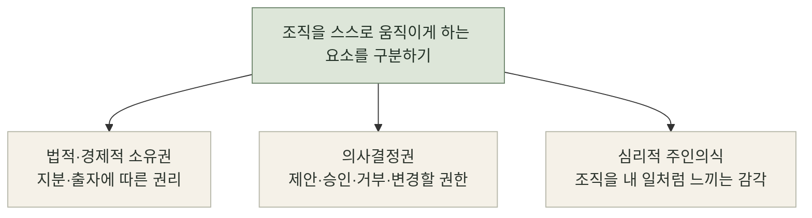
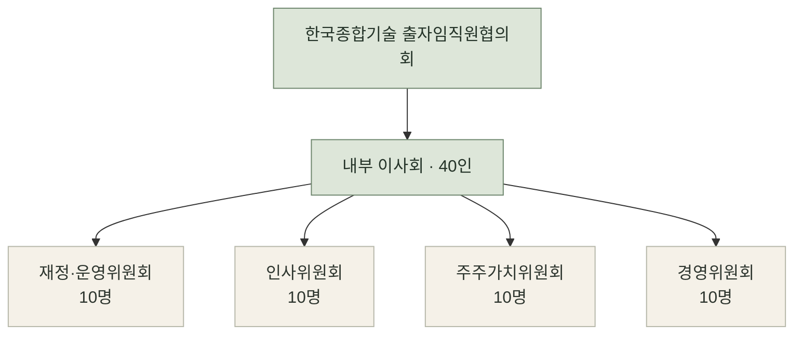
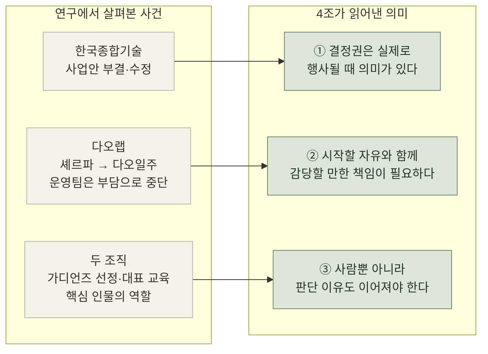
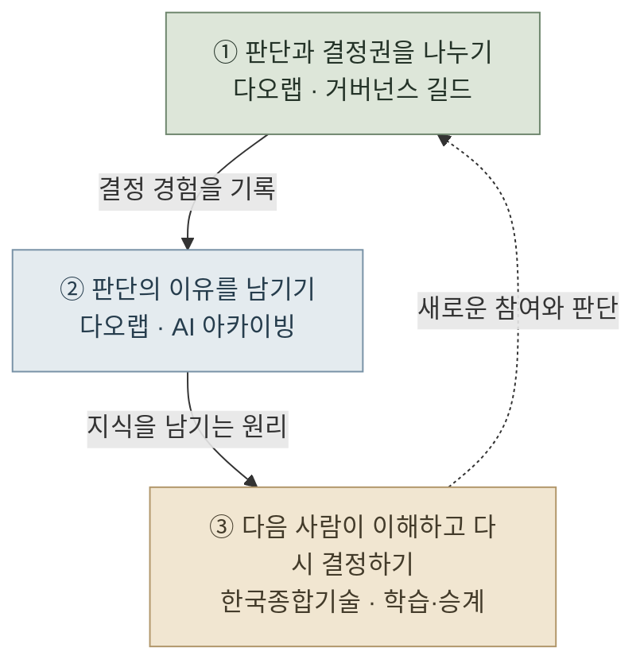

4조 코오너스는 다오랩과 직원소유기업 한국종합기술을 비교하며 “조직은 어떻게 스스로 움직이는가?” 를 탐구했습니다. 이 글은 쇼케이스에서 생략한 연구 배경과 실제 사례, 세 가지 제언의 실행 방법을 더 자세히 설명합니다.

## 질문이 좁혀진 과정

### 왜 이 연구를 했을까?

우리는 **구성원이 스스로 판단하고 기여하며, 조직의 성장과 성과도 함께 나누는 미래 조직**을 찾고 싶었습니다.

소유권과 중요한 결정이 소수에게 집중된 조직에서는 리더가 과도한 책임을 지기 쉽습니다. 다른 구성원은 결정에 영향을 미칠 기회가 적어지고요. 권한이 부족해 자율성이 줄면, 조직을 함께 만드는 사람보다는 **정해진 보상을 받고 맡은 일만 하는 사람**으로 머물 수 있다는 문제의식에서 출발했습니다.

그렇다면 소유권이나 결정권을 나누면 해결될까요? 또 리더가 바뀌어도 조직이 계속 움직이려면 무엇이 필요할까요?

### 왜 이 두 조직을 비교했을까?

다오랩은 법적 지분을 나누지 않아도 구성원이 길드와 행사를 자발적으로 엽니다. 한국종합기술은 직원들이 출자해 회사를 소유하고, 선출된 대표 기구를 통해 중요한 사업안을 심의합니다. **한쪽은 스스로 시작하는 경험이, 다른 한쪽은 제도를 통해 결정하는 경험이 뚜렷한 사례**였습니다.

| 구분             | 다오랩                                                       | 한국종합기술                                           |
| ---------------- | ------------------------------------------------------------ | ------------------------------------------------------ |
| 소유             | 법적 공동소유가 참여의 조건은 아님                           | 직원 출자와 경제적 이해관계 공유                       |
| 새로운 일의 시작 | 구성원이 길드·프로젝트를 자유롭게 제안                       | 사업부 등이 공식 안건을 준비·상정                      |
| 중요한 결정      | 길드 내부는 자율적, 공동체 전체는 랩장에게 의존하는 부분이 있음 | 출자임직원협의회의 40인 내부 이사회가 심의·의결        |
| 남아 있는 과제   | 공동체 차원의 판단과 조율을 어떻게 나눌까?                   | 제도의 취지와 판단 경험을 다음 대표에게 어떻게 전할까? |

**시각화 ① · 소유권, 결정권, 주인의식은 서로 다른 개념**

*세 개념은 서로 관련될 수 있지만 동일하지 않습니다. 한 가지가 있다고 나머지 두 가지가 자동으로 생기는 것은 아닙니다.*

이번 연구에서 구분한 개념은 세 가지입니다. **소유권**은 지분·출자에 따른 법적·경제적 권리, **의사결정권**은 안건을 승인·거부·변경할 수 있는 권한, **심리적 주인의식**은 조직을 자신의 일처럼 느끼는 감각입니다. 이 세 가지는 서로 연결될 수 있지만 같은 것은 아닙니다.

## 방법

### 핵심 관계자 인터뷰를 바탕으로 한 탐색적 질적 비교 사례연구

두 조직의 운영과 자발적인 기여를 가까이서 경험한 **네 명**을 인터뷰했습니다. 인터뷰 대상은 한국종합기술 출자임직원협의회 김영수 위원회장, 다오랩 랩장, 가디언즈·길드 운영자, 커뮤니티 운영 경험을 가진 대표입니다. 질문지를 바탕으로 구체적인 사건을 듣고, 누가 제안하고 결정하며 실행했는지 비교했습니다.

4조는 자료를 다섯 갈래로 나누어 살펴봤습니다.

| 연구 갈래                    | 살펴본 질문                                                  |
| ---------------------------- | ------------------------------------------------------------ |
| 직원소유기업의 거버넌스 구조 | 소유권과 공식 결정권은 어떻게 연결되는가?                    |
| 가디언즈의 역할과 참여 동기  | 누가 공동체의 중요한 문제를 논의하며, 어떤 경험에서 보람을 느끼는가? |
| 자발적으로 등장한 리더       | 새로운 일을 누가 시작하고 동료는 왜 합류하는가?              |
| 의제 발의와 의사결정 방식    | 공식 절차와 비공식적인 조율은 실제 결정에 어떤 영향을 미치는가? |
| 참여 동기와 보상 구조        | 금전적 보상 외에 무엇이 참여를 지속시키며, 언제 부담이 되는가? |

인터뷰 내용을 사건별로 정리하고 두 조직을 같은 질문으로 비교해 공통점과 차이를 찾았습니다. **팀원이 작성한 의제·의사결정 비교 자료와 AI 정리본은 같은 인터뷰를 재구성한 2차 분석자료**이므로 별도의 독립된 검증 근거로 세지 않았습니다.

**연구의 범위.** 일반 구성원을 폭넓게 면담한 조사, 체계적인 현장·참여관찰, 참여 행동 로그 분석, 대표성 있는 설문조사나 성과지표를 활용한 정량분석은 하지 않았습니다. 따라서 이 연구는 두 조직에서 **어떤 방식이 작동하고 어떤 문제가 남는지 이해하고 다음 실험을 설계하는 탐색적 연구**입니다. 참여율 향상이나 주인의식 증가의 효과를 측정한 연구는 아닙니다. 아래 인용은 인터뷰 전사·발표 기록을 바탕으로 했으며, 공개용 직접 인용은 당사자 확인이 필요합니다.

## 지금까지 나온 것

### 1. 한국종합기술: 중요한 결정을 나누도록 만든 구조

**한국종합기술에는 출자임직원협의회의 40인 내부 이사회가 있습니다.** 인터뷰에서 김영수 위원회장은 이 기구의 운영과 중요한 안건이 어떻게 심의되는지 설명했습니다. 여기서 **'이사회'는 협의회 내부의 명칭**으로, 주식회사법상 법적 이사회와 동일한 기구라는 뜻은 아닙니다.

40인 내부 이사회는 주요 의사결정 영역에 따라 네 분과로 나뉩니다.

| 분과위원회      | 인원 |
| --------------- | ---: |
| 재정·운영위원회 | 10명 |
| 인사위원회      | 10명 |
| 주주가치위원회  | 10명 |
| 경영위원회      | 10명 |

이는 한국종합기술이 **주요 경영 의사결정 영역**을 나누어 검토하는 구조를 보여줍니다. 별도로 대표이사와 법적 이사회, 관계 법인·조합의 의사결정 체계도 존재하므로, 이 그림만 보고 회사의 모든 결정이 40인 기구에서 이루어진다고 해석해서는 안 됩니다.

**시각화 ② · 한국종합기술 출자임직원협의회의 내부 의사결정 구조**

*협의회 내부의 40인 의결 구조만 단순화했습니다. 회사의 법적 이사회와는 별개입니다.*

> “회사에서 다 하는데 뭘 나보고 결정해 달라는 거야?”  
> — 김영수 위원회장이 소개한 초기 구성원들의 반응, 4조 인터뷰·발표 기록

처음부터 이 구조의 결정권이 활발하게 행사된 것은 아니었습니다. 김영수 위원회장에 따르면 초기에는 심의가 형식적인 절차로 받아들여지기도 했습니다. 그러나 내부 이사회가 **사업안을 부결하고, 제안 측이 수익성 전망을 보완해 다시 상정한 사례**가 있었습니다. 그 뒤 안건 준비가 더 꼼꼼해지고, 구성원들도 반대 의견을 내기 시작했다고 설명했습니다.

이 사례에서 4조가 주목한 것은 특정 수익률의 차이가 아닙니다. **심의 기구가 실제로 안건을 반려하고 수정하도록 만들 만큼 결정권을 행사했다**는 사실입니다. 출자만으로 주인의식이 완성되는 것이 아니라, 자신의 결정이 실제 결과에 영향을 주는 경험이 중요하다는 단서를 얻었습니다.

### 2. 다오랩 가디언즈: 신뢰받는 사람을 모아도 결정권은 남는다

랩장은 다오랩에 대한 애정, 누적된 기여, 맡은 일을 끝맺는 태도를 보고 가디언즈 참여를 요청했다고 설명했습니다. 가디언즈에서는 구성원 문제나 길드 수익 배분처럼 공동체에 영향을 미치는 사안을 논의했습니다.

가디언즈 참여자는 서로 의견을 자유롭게 나누고 랩장이 이를 정리하는 과정을 설명했습니다. 하지만 독립적인 표결 기준이나 최종 결정 범위까지 정해진 기구는 아니었습니다.

여기서 구분할 것은 **신뢰받는 사람을 발견하는 일**과 **그 사람에게 공동체를 대표할 권한을 맡기는 일**입니다. 둘은 이어질 수 있지만 같은 일이 아닙니다.

### 3. 다오일주: 기여 경험이 새로운 일을 시작하게 한 사례

한 참여자는 셰르파 활동을 하면서 기수 운영을 직접 경험했고, 이후 다오일주 길드를 열었습니다. 랩장은 길드 운영을 대신하지 않았고 동료들은 행사별로 필요한 역할을 맡았습니다.

> “그 커뮤니티에 내가 얼마나 기여하냐가 그 커뮤니티가 내 거가 되냐 안 되냐에 문제가 달려 있다.”  
> — 가디언즈·길드 운영자 인터뷰, 4조 녹취 기록

인터뷰 참여자가 **기여하면서 소속감과 주인의식이 커졌다고 느낀 경험**을 보여주는 말입니다. 이 경험은 자발적인 프로젝트 발의의 한 사례지만, 모든 구성원에게 같은 순서로 변화가 생긴다고 볼 근거는 아닙니다.

한편 다오랩에서는 정기 회의와 과제를 맡는 운영팀이 초기에 지원자를 모았음에도 부담이 커져 지속되지 못한 경험도 있었습니다. **자율적인 참여 기회와 감당할 수 있는 책임을 함께 설계해야 한다**는 교훈이 여기서 나옵니다.

### 4. 두 조직의 결정 방식: 누가 의제를 만들고 마지막 결정을 내릴까?

한국종합기술은 주요 사업안을 공식 안건으로 올려 토론과 표결을 거칩니다. 김영수 위원회장은 처음에는 우호적인 분위기를 미리 만들기도 했지만, 여러 의견이 공개적으로 부딪히는 토론의 중요성을 더 크게 느끼게 됐다고 설명했습니다.

다오랩에서는 길드 구성원이 자유롭게 활동을 제안합니다. 그러나 공동체 전체에 영향을 미치는 사안에서는 랩장의 의제 제시와 조율이 큽니다. 랩장은 현재 방식을 이렇게 표현했습니다.

> “제가 지금 하는 모델이 자애로운 독재자 모델이거든요.”  
> — 다오랩 랩장 인터뷰, 4조 녹취 기록

랩장은 다른 사람들도 공동체 거버넌스에 참여하려면 **직접 판단해 보는 학습 과정**이 필요하다고 봤습니다. 또한 관심 있는 사람들을 미리 만나 연결하는 ‘판짜기’를 활용한다고 설명했습니다. 이는 새로운 일을 시작할 사람을 연결하는 기능이지만, 중요한 결정의 정당성과는 별개로 살펴볼 필요가 있습니다.

두 조직을 비교하면 **다오랩은 새로운 일의 발의가 분산되어 있고, 한국종합기술은 중요한 결정의 공식적인 권한을 나눈 모습**이 두드러집니다. 다만 두 조직 모두 일부 중요한 기능은 핵심 인물에게 남아 있었습니다.

### 5. 참여 동기와 보상: 사람들이 계속 기여하는 이유는 무엇일까?

다오랩 인터뷰에서는 관계, 운영을 배우는 경험, 자신의 의견이 반영되는 순간, 공동체에 대한 애정이 참여 이유로 나타났습니다. 동시에 운영 업무가 길어지면 부담이 커질 수 있다는 경험도 있었습니다.

한국종합기술에서는 출자를 통해 구성원과 기업의 경제적 이해관계를 연결합니다. 김영수 위원회장이 전한 **회의수당을 지급하지 않기로 한 결정**은 대표 기구 참여가 금전적 보상만으로 설명되지는 않는다는 단서였습니다.

이 두 사례에서 **돈·관계·성장·결정에 미치는 영향·시간 부담**을 분리해 생각해 볼 수 있습니다. 다만 기여나 주인의식에 어떤 요인이 더 크게 작용했는지 비교할 구성원 조사자료는 확보하지 못했습니다. 보상과 동기의 관계는 이번 연구에서 충분히 다루지 못한 영역입니다.

### 세 가지 발견으로 정리하면

| 연구에서 발견한 것                                           | 대표 사례                              | 이 발견이 뜻하는 것                                          |
| ------------------------------------------------------------ | -------------------------------------- | ------------------------------------------------------------ |
| **1. 결정권은 실제로 행사될 때 의미가 생긴다.**              | 한국종합기술의 사업안 부결·재상정      | 투표권이나 대표 직책이 있다는 사실과 실제 결과에 영향을 주는 경험은 다르다. |
| **2. 자발적인 시작에는 기여 경험과 부담의 크기가 중요하다.** | 셰르파 → 다오일주, 운영팀 중단         | 누구나 시작할 수 있어도 일처럼 느껴지면 참여가 끊길 수 있다. |
| **3. 사람을 교체하려면 판단의 이유도 이어져야 한다.**        | 가디언즈 초대, 신임 이사회 구성원 교육 | 누가 다음 역할을 맡을지뿐 아니라 어떤 기준으로 판단했는지 남겨야 한다. |

**시각화 ③ · 대표 사건에서 세 가지 발견까지**

*화살표는 사례를 바탕으로 연구팀이 정리한 의미를 나타냅니다. 통계적으로 검증된 인과관계는 아닙니다.*

### 서로에게 적용한다면

**한국종합기술 → 다오랩: 결정의 책임을 분명히 하는 방법**

다오랩에서는 길드의 자율적인 활동을 유지하면서도 **공동체 전체에 영향을 주는 문제는 누가 의견을 듣고, 언제 논의를 마치며, 누가 결정하고 책임지는지** 분명하게 할 필요가 있습니다. 이는 현재의 작당회나 공동 판단 실험에서도 바로 적용해볼 수 있는 원칙입니다.

**한국종합기술 → 다오랩: 중요한 의사결정 영역을 나누는 방법**

한 걸음 더 나아가, 한국종합기술처럼 분야별 검토 기능을 나누는 방안도 생각해볼 수 있습니다. 한국종합기술이 재정·운영, 인사, 주주가치, 경영이라는 **주요 경영 의사결정 영역**에 따라 분과위원회를 구성했듯, 다오랩도 공동자원·예산, 멤버십·갈등, 활동·프로젝트, 공동체 원칙·방향처럼 주요 쟁점을 구분할 수 있습니다.

다만 **분야를 나눈다는 것이 곧 네 개의 상설 위원회를 만들자는 뜻은 아닙니다.** 먼저 실제로 논의가 필요한 안건에서 작은 자원자 모임을 운영해보고, 어떤 영역에 상시적인 판단 기능이 필요한지 확인할 수 있습니다. 필요성이 확인된다면 장기적으로 분야별 분과를 갖춘 **공동체 대표·의결 기구**를 설계하는 것도 선택지입니다. 이 경우 구성원들이 대표 선출 방법, 의결 범위, 임기와 책임, 이의 제기 절차를 먼저 합의해야 합니다. 분과 구성이 구성원들에게 또 하나의 운영 의무가 될 가능성도 함께 살펴야 합니다.

**다오랩 → 한국종합기술: 구성원이 제도의 의미를 직접 검토하는 경험**

한국종합기술에는 이미 대표 선출과 의결 구조가 있습니다. 따라서 새로운 의견 수렴 창구를 추가하기보다, 신임 대표들이 **왜 직원소유를 선택했고 어떤 문제를 해결하려고 현재의 제도를 만들었는지** 직접 검토해보는 것이 유용할 수 있습니다. 조직의 역사를 이해한 다음 무엇을 지키고 바꿀지 토론하고, 그 판단 이유를 다음 기수에 남기는 방식입니다. 이때 입찰·가격·고객·미공개 수익성 같은 정보는 별도로 보호해야 합니다.

## 가져다 쓸 도구

4조는 앞서 살펴본 두 조직의 경험을 바탕으로, **다오랩과 한국종합기술에 다음 세 가지 실험을 제안합니다.** 각각 필요한 문제부터 작게 시작하고, 실제 운영 결과를 살펴보며 발전시키는 방식입니다.

### 1. 거버넌스 길드(가칭): 공동 판단에서 자치로

**왜 제안하나?** 다오랩은 길드 활동을 스스로 시작하는 문화가 있지만, 공동체 전체의 중요한 결정과 조율은 아직 랩장에게 모입니다. 곧바로 상설 운영진을 만들면 과거처럼 새로운 업무가 될 수 있습니다.

**이렇게 시도할 수 있습니다.**

| 단계                      | 구성원이 해볼 일                                      | 랩장 역할                                   | 다음 단계로 넘어갈 때 확인할 것                            |
| ------------------------- | ----------------------------------------------------- | ------------------------------------------- | ---------------------------------------------------------- |
| **1. 공동 판단**          | 실제 안건의 이해관계자를 찾고 의견·대안을 정리        | 최종 결정과 이유를 공유                     | 구성원이 스스로 대안을 만들고 이견을 다룰 수 있는가?       |
| **2. 제한적 결정권 위임** | 작고 되돌릴 수 있는 안건에서 직접 결정하고 실행       | 범위·예외 조건을 사전에 합의한 뒤 결정 존중 | 랩장 개입 없이 결정을 마무리하고 실행하는가?               |
| **3. 자치적 거버넌스**    | 공동체의 중요한 결정과 운영 원칙까지 스스로 검토·변경 | 지속적인 개입 없이 역할을 넘김              | 대표성·책임·이의 제기 절차를 공동체가 정당하게 운영하는가? |

**주의할 점.** 의견을 모은 사람이 자동으로 대표권을 얻지는 않습니다. 1단계의 권한은 의견 수렴과 대안 제시이고, 2단계부터는 결정 범위·논의 종료 시점·이견 처리 방식을 미리 합의해야 합니다. 처음부터 제재나 공동 자금 같은 큰 문제를 다루지 않습니다. 참여는 자원하는 방식으로 운영하고 기간과 과업을 제한합니다.

**잘되고 있다는 신호.** 랩장이 답을 주기 전에 대안이 만들어지고, 위임된 결정이 실제로 실행되며, 그 과정 때문에 사람들이 과도한 부담을 느끼지 않는 것입니다.

### 2. AI 의사결정 기록: 결론과 함께 이유도 남기기

**왜 제안하나?** 랩장의 판단이 계속 필요한 이유 중 하나는 지난 결정의 맥락을 그 사람만 알고 있기 때문일 수 있습니다. 하지만 회의록 작성을 새로운 운영 업무로 만들면 또 다른 부담이 생깁니다.

**이렇게 시도할 수 있습니다.** 최근 공동체에서 내린 결정 한 건을 골라 아래 순서로 진행합니다.

1. **기록 가져오기:** 참여자의 동의를 받은 논의 기록을 AI가 읽습니다.
2. **초안 만들기:** 안건·선택지·결론·판단 이유·남은 이견을 5줄로 요약합니다.
3. **당사자 확인:** 결정에 참여한 사람들이 사실관계와 공개 범위를 검토하고 수정·승인합니다.
4. **사례 보관:** 승인된 내용만 다음 사람이 검색할 수 있도록 저장합니다.

자동화가 고장 났을 때는 관리자가 고치고, **내용의 정확성은 결정에 참여한 사람이 확인**합니다.

**주의할 점.** 개인 갈등·제재·사생활을 다룬 기록은 자동 수집하지 않습니다. AI가 개인의 기여도를 점수화하거나 대표자를 추천·선정하지 않도록 합니다. 기존 [결정 남기기](../../guides/decisions.md)와 [봇과 자동화](../../guides/automation.md)에 연결하면 별도 시스템을 크게 만들지 않고 시작할 수 있습니다.

**잘되고 있다는 신호.** 과거 결정을 찾는 시간이 줄고, 같은 맥락을 랩장에게 다시 묻지 않고도 구성원이 다음 결정을 검토할 수 있는 것입니다.

### 3. 거버넌스 학습·승계: 제도를 만든 이유를 다음 대표에게

**왜 제안하나?** 한국종합기술에는 이미 직원소유와 선출된 대표 기구가 있습니다. 문제는 그 구조를 만들어 온 핵심 인물이 물러난 뒤에도 **왜 이런 제도를 택했는지** 충분히 이해한 상태에서 판단할 수 있느냐는 것입니다.

**이렇게 시도할 수 있습니다.** 다음 신임 대표 교육이나 임기 종료 회고에서 중요한 규정 하나를 골라 네 질문을 함께 다룹니다.

1. **도입 배경:** 이 규정은 왜 만들었을까?
2. **현재의 적합성:** 지금도 그 이유가 유효할까?
3. **유지·개선:** 무엇을 유지하고 무엇을 바꿀까?
4. **다음 기수로 전수:** 이번 판단의 이유를 어떻게 남길까?

결론만 남기지 말고 당시 검토한 대안과 반대 이유도 간단히 기록합니다.

**주의할 점.** 과거의 원칙을 무조건 지키게 하려는 교육이 아닙니다. 새로운 대표가 맥락을 이해한 뒤 정당한 절차로 다른 결정을 내릴 수 있어야 합니다. 입찰·가격·고객·미공개 사업정보는 교육용 사례와 분리하고, 의결권자의 판단에 필요한 정보 접근은 보장합니다.

**잘되고 있다는 신호.** 핵심 인물이 직접 설명하지 않아도 새 대표가 제도의 취지를 설명하고, 과거의 이유를 근거로 지금의 규칙을 스스로 검토하는 것입니다.

**시각화 ④ · 세 가지 제언이 연결되는 방식**

*서로 다른 조직에 제안한 실험을 하나의 학습 흐름으로 정리한 개념도입니다. 두 조직 사이에 기록이 실제로 전달된다는 뜻은 아닙니다.*

## 결론: 스스로 움직이는 조직에 가까워지는 세 가지 조건

이 연구에서 본 두 조직은 출발점이 다릅니다. 다오랩에서는 **스스로 일을 시작하는 기회**가 넓고, 한국종합기술에서는 **구성원의 결정이 실제 사업안을 바꾸는 제도**가 나타났습니다. 동시에 두 조직 모두 특정 리더에게 남아 있는 판단과 조율 기능이 있었습니다.

4조가 제안한 실험은 서로 연결됩니다. **결정할 권한을 실제로 나누는 경험 → 그때의 판단 이유를 조직의 기억으로 남기는 일 → 다음 사람이 맥락을 이해하고 다시 결정하는 과정**입니다. 지향하는 조직은 리더가 필요 없는 조직이 아니라, 필요한 때 새로운 리더가 등장하고 역할이 바뀌어도 공동체의 경험이 이어지는 조직입니다.

## 후속 연구: 기여와 신뢰는 어떻게 결정권으로 이어질까?

기여 경험과 신뢰는 다음 역할을 맡을 사람을 발견하는 데 도움이 될 수 있습니다. 그러나 **사람들이 신뢰한다는 사실**과 **그 사람이 공동체 전체를 대신해 결정할 정당한 권한을 갖는 것**은 다릅니다. 누가 참여하고 어떤 절차로 위임하며, 필요할 때 어떻게 교체할 것인지는 다음 연구에서 다룰 질문입니다.
